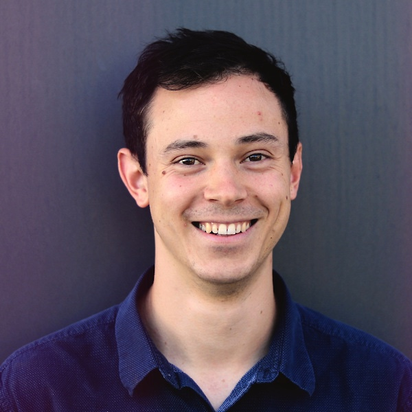
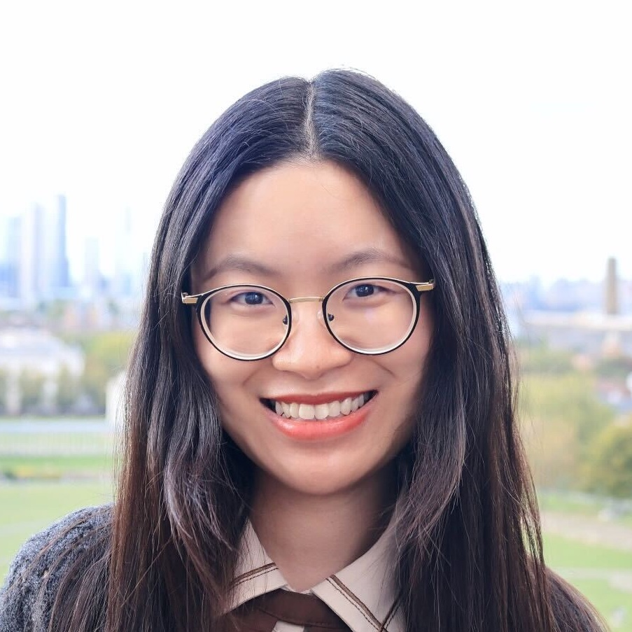
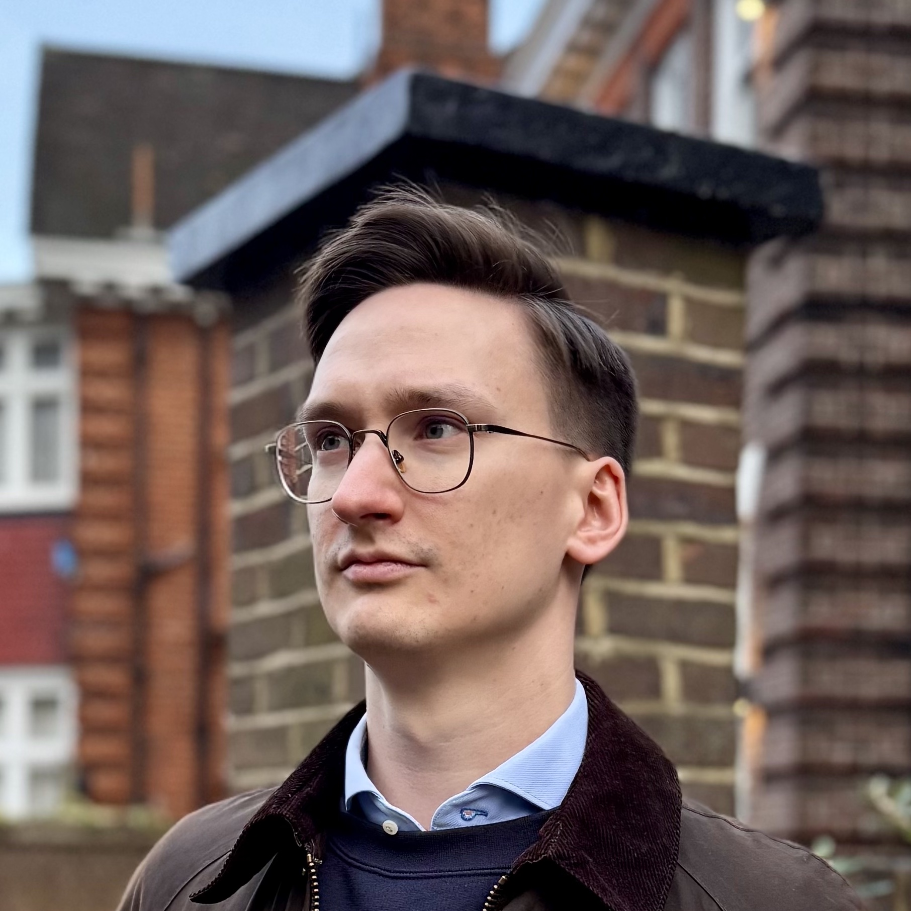
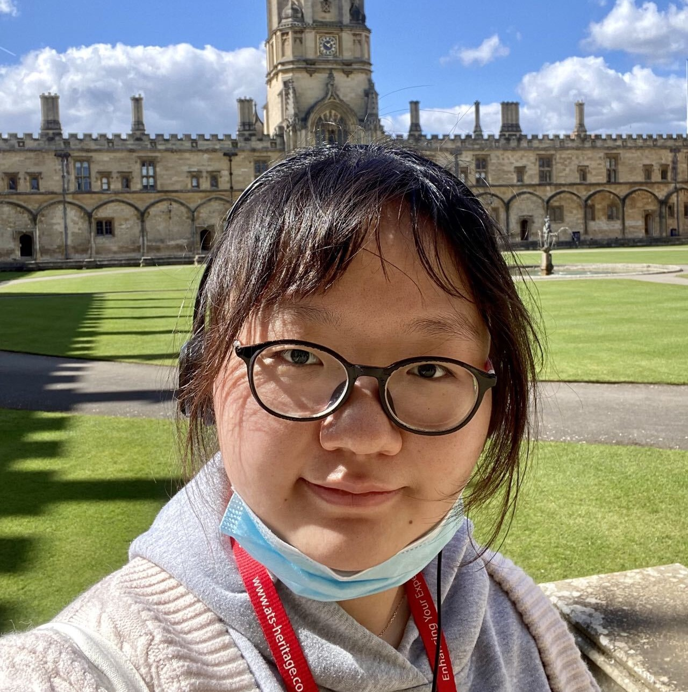
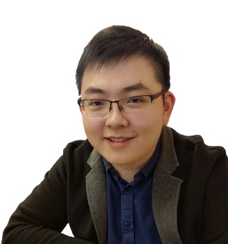
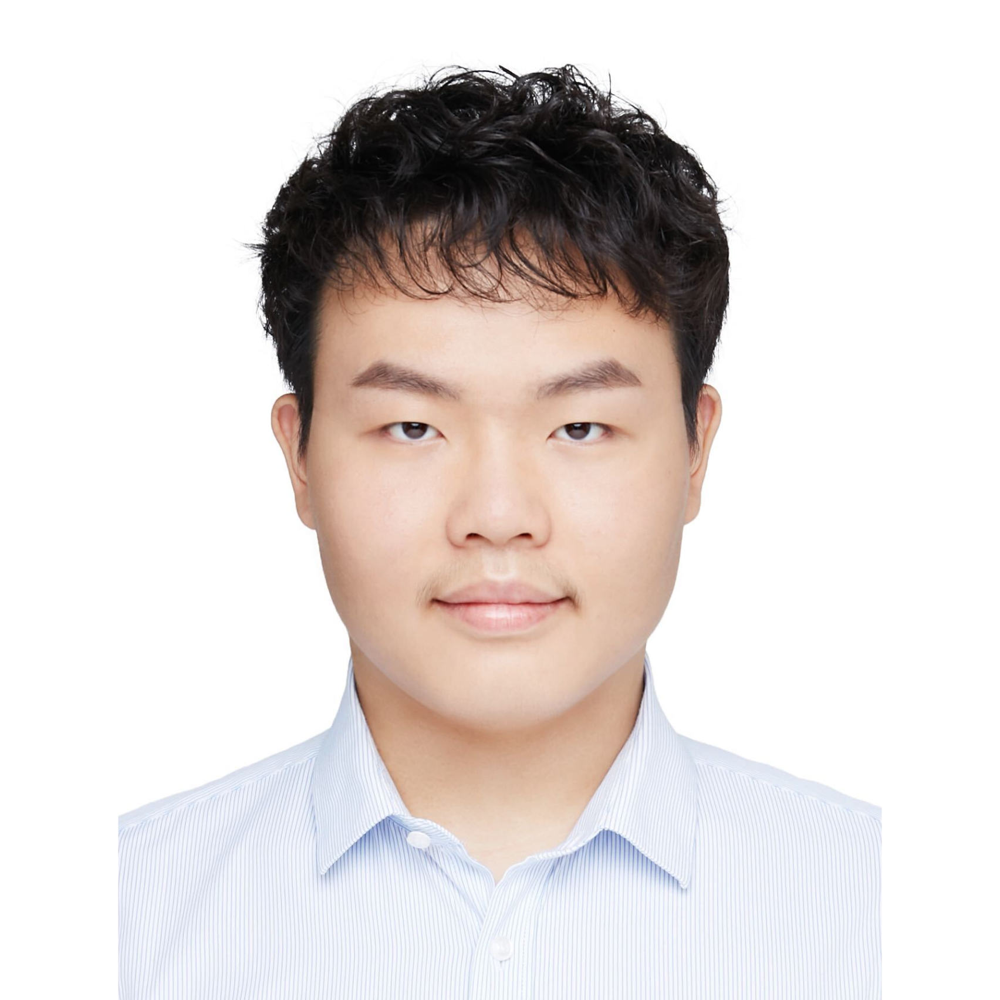
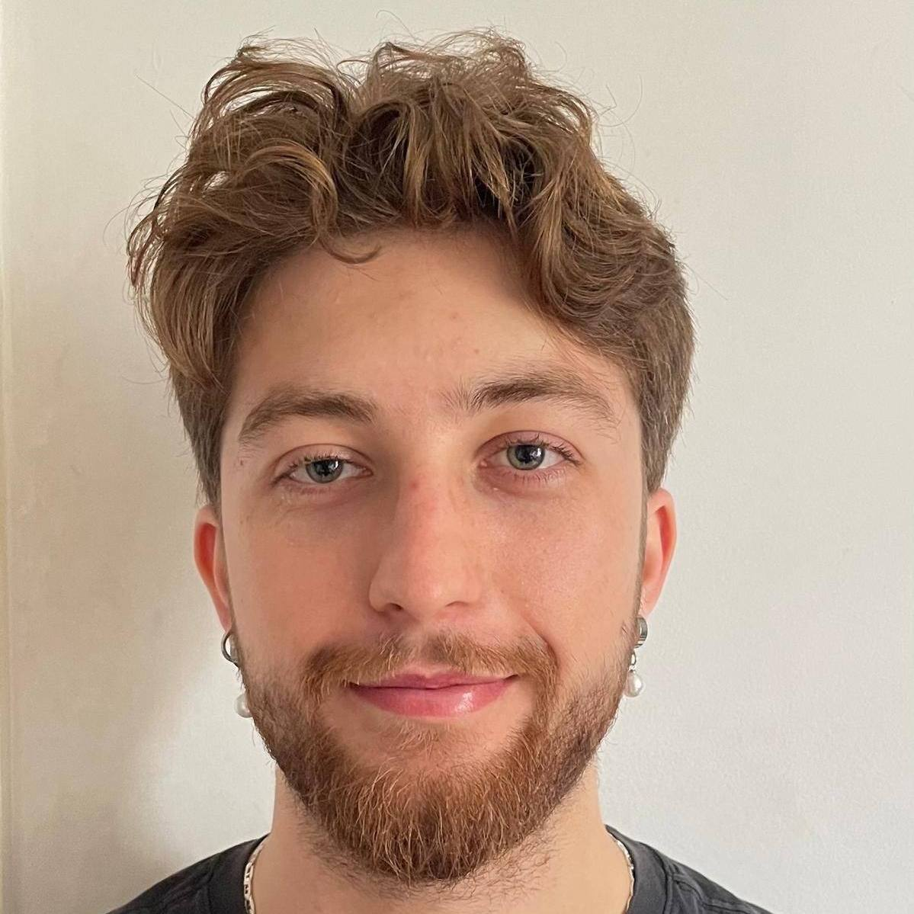
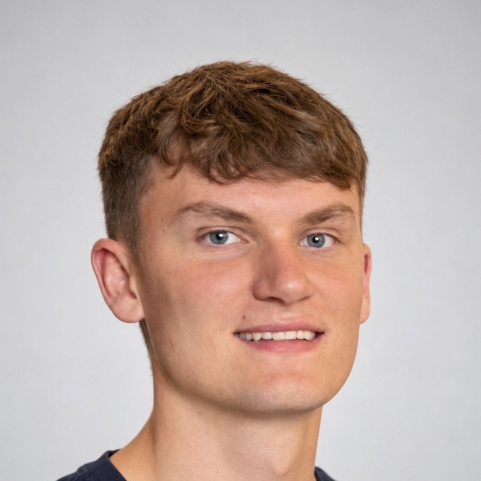
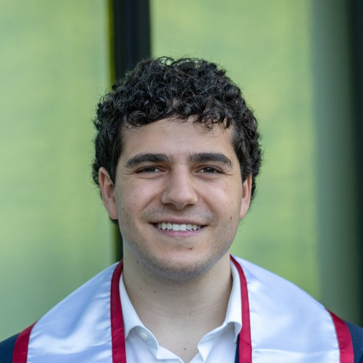
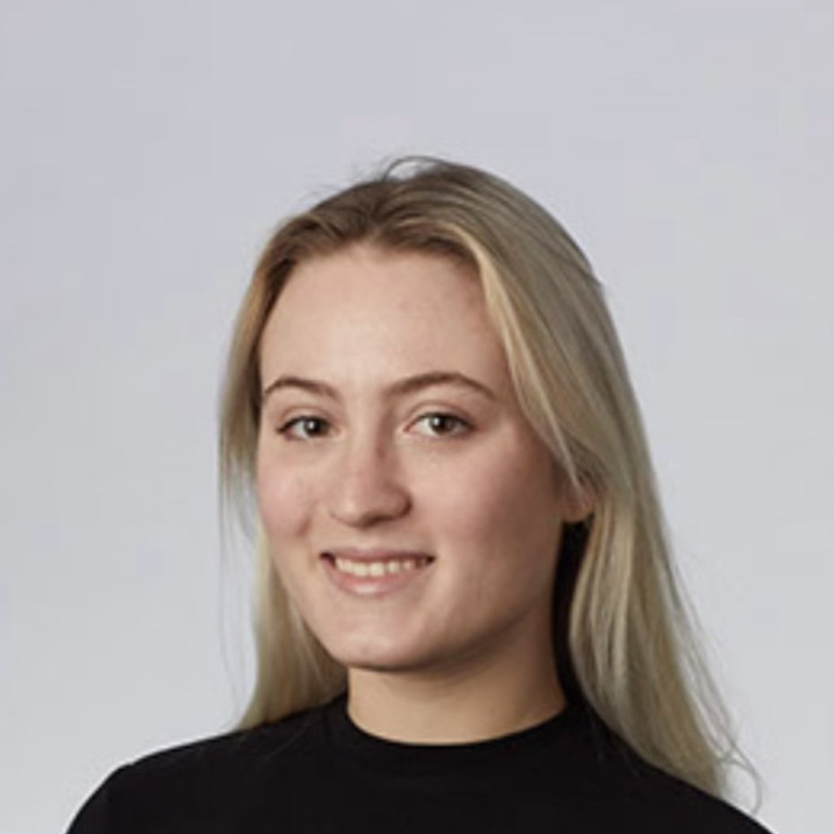

:   ## Dr. Alex Ganose

    Associate Professor, Imperial College London

    Co-investigator, [Materials Project](https://materialsproject.org)

    

    <a href="https://www.imperial.ac.uk/people/a.ganose">Website</a> |
    <a href="https://scholar.google.com/citations?user=nVJFXWwAAAAJ&hl=en">Scholar</a> |
    <a href="https://github.com/utf">GitHub</a>

    

    Alex Ganose is an Associate Professor in the Department of Chemistry at Imperial College London.

    

    His research uses computational materials chemistry, machine learning,
    and data science to design new materials for pressing  problems,
    including renewable energy generation (photovoltaics, thermoelectrics and transparent conductors) and
    energy storage.

    

    Alex was awarded his EngD in chemistry from University College London in 2018.
    After a Postdoctoral position at
    Berkeley Lab, California he joined Imperial as an EPSRC Fellow in 2021.
    In 2022, he was appointed as a Lecturer in the Department of Chemistry, followed by an Associate Professor in 2025.
    He is a co-investigator at the [Materials Project](http://materialsproject.org).

    

    You can contact Dr Alex Ganose [by email](mailto:a.ganose@imperial.ac.uk).

## Senior Researchers

:   ## Dr Xinwei Wang

    Project: *Accelerated defect modelling with machine learning*

    

    <a href="https://scholar.google.com/citations?user=Ul36LhUAAAAJ&hl=en&oi=ao">Scholar</a> |
    <a href="https://github.com/xw-w">GitHub</a>

    

    Xinwei Wang is an Eric and Wendy Schmidt AI in Science Postdoctoral Fellow in the Department of Chemistry at
    Imperial College London. She obtained her PhD in Materials from the same institution. Her research interests
    are accelerating the identification and optimisation of emerging solar absorbers using data-driven approaches.
    During her fellowship, she's focused on using AI and machine learning techniques to advance defect modelling.
    In her free time, Xinwei enjoys photography and hiking.

:   ## Dr Wojciech Stark

    Project: *Multi-fidelity closed-loop Bayesian optimisation of chemical experiments*

    

    <a href="http://wgst.github.io">Website</a> |
    <a href="https://scholar.google.com/citations?user=KiNdem8AAAAJ">Scholar</a> |
    <a href="https://github.com/wgst">GitHub</a>

    

    Wojciech obtained his PhD in Chemistry from University of Warwick, where he developed machine learning models for
    gas-surface dynamics using uncertainty-driven adaptive sampling. In 2025, he joined Imperial as a Research Associate
    in AI for Chemistry, focusing on multi-fidelity closed-loop Bayesian optimisation for chemical experiments. In his
    free time, Wojciech enjoys fitness activities, attending operas, and watching stand-up comedy.

## PhD Students

:   ## Ruiqi Wu

    Project: *Designing novel photovoltaics through machine learning*

    

    <a href="https://scholar.google.com/citations?user=ZBw2oKYAAAAJ&hl=en">Scholar</a> |
    <a href="https://github.com/Ruiqi-Wu">GitHub</a>

    

    Ruiqi grew up in China, from a small city where Tofu is believed to originate from.
    She obtained undergraduate degrees in Materials Engineering at both the University
    of British Columbia (Canada) and Chongqing University (China) where she investigated metal
    processing, batteries and transistors. After graduating with a distinction in
    Advanced Materials Science from UCL, Ruiqi joined the group in November 2022 as
    the first PhD student, focusing on designing earth-abundant photovoltaics.
    When she’s not studying, Ruiqi enjoys cooking, manga and fossil hunting.

:   ## Leo Lou

    Project: *Machine learning to accelerate the discovery of energy materials*

    

    <a href="https://github.com/leolou0512">GitHub</a>

    

    Leo is a second year PhD student in the Virtual Atoms Group. He joined the group in 2022 as a Masters
    student as part of his undergraduate degree, and continued as a PhD student in 2023. Since then, he
    has been applying machine learning to problems in chemistry and materials. He is currently working on
    generative models for crystalline materials. Leo is an amateur classical pianist, Magic the Gathering
    player, and an enthusiast for PC games.

:   ## Shirui Wang

    Project: *Finite-temperature materials discovery*

    

    <a href="https://scholar.google.com/citations?hl=en&user=S9-YNBIAAAAJ">Scholar</a>

    

    Shirui Wang graduated with a Bachelor of Science degree in Chemistry from the University of
    Birmingham in July 2022. He then completed a Master of Research (MRes) in Nanomaterials at
    Imperial College with distinction. Shirui joined the group in December 2022 as a master student,
    working on a project titled Computational Insights into Emerging Chalcogenide Perovskite Photovoltaics.
    Following the completion of his master, he continued with the group as a PhD student, now focusing on
    replacing heavy DFT calculations with machine learning techniques.

:   ## Viktor Ellingsson

    Project: *Halide solid electrolytes for all-solid-state batteries*

    

    <a href="https://scholar.google.com/citations?hl=en&user=-etG0EoAAAAJ">Scholar</a> |
    <a href="https://github.com/Viktore224">GitHub</a>

    

    Viktor is a President’s PhD Scholar in the Department of Chemistry at Imperial College London.

    

    Viktor is from Iceland and graduated with a BSc in Chemistry with a focus on computational techniques
    from the University of Iceland. His BSc project looked at the computationally aided design of ammonia
    NRR catalysts with Prof. Egill Skúlason in collaboration with Atmonia. After the BSc degree he spent one
    year in the United States at the University of California Santa Barbara attending the UCSB Extension program.
    In 2022, he joined the STEM Group at the University of Oxford supervised by P. D. Nellist, R. J. Nicholls, and
    P. G. Bruce. At Oxford he explored the redox mechanism of disordered rocksalt Li-ion cathode materials using
    electron microscopy and computational modelling. Viktor joined the Virtual Atoms Lab group in November 2023.
    In his spare time, Viktor enjoys reading, listening to music, and brewing coffee as well as playing Badminton.

:   ## Dylan John

    Project: *Hard-constraints for chemical generative models*

    Co-supervisors: *Prof. Kim Jelfs, Dr Eleonora Giunchiglia*

    

    <a href="https://github.com/dylancjohn">GitHub</a>

    

    Dylan joined the group in September 2025 after completing his MChem degree at the University of Oxford.
    His research focuses on integrating constraints into generative models.

:   ## Pablo Graf

    Project: *Data-driven approaches for reaction mechanism discovery*

    Co-supervisors: *Prof. Kim Jelfs, Dr Becky Greenaway*

    

    <a href="https://github.com/PabloGraf">GitHub</a>

    

    Pablo is a PhD student from Barcelona, Spain, funded by AIChemy. He graduated with an MSci in
    Chemistry from the University of Bristol, where he investigated the excited-state potential energy surfaces
    and photoswitching capabilities of a novel phosphine-based azobenzene derivative under the supervision of
    Prof. Basile Curchod. He also obtained an MRes in Multidisciplinary Sciences from Universitat Pompeu Fabra
    and the Institute of Photonic Sciences, where he developed an OT-2-based automated platform for testing
    RuO₂ based oxygen evolution reaction electrocatalysts under the supervision of Prof. F. Pelayo García de
    Arquer. Since joining Imperial, he has been helping to develop a closed-loop platform for the discovery of
    chemical reaction mechanisms based on reaction kinetics.

:   ## Cameron Reid

    Project: *Data-driven modelling of polymer biotransformation and biodegradation*

    Co-supervisors: *Prof. Dr. George Britovsek, Dr Agi Brandt-Talbot, Dr Florence Huynh (Polymateria)*

    

    <a href="https://scholar.google.com/citations?user=z2FxIIwAAAAJ&hl=en">Scholar</a>

    

    Cameron is from Cambridge. He studied Chemistry at the University of Edinburgh before completing an MRes in
    Green Chemistry at Imperial. He then spent a year as a Research Technologist at Polymateria, working on
    accelerated ageing and service life prediction of polyolefins. He joined the group in October 2026 as a CASE
    PhD student with Polymateria. His project combines machine learning, accelerated ageing experiments and
    computational chemistry to design polyolefins with controlled degradability. Outside the lab, Cameron plays
    basketball and football and loves cooking.

:   ## Gabriel Greenstein

    Project: *Unifying matter: a foundation generative model for materials and molecular design*

    Co-supervisors: *Dr Joey Bose, Dr Shelly Conroy*

    

    <a href="https://github.com/GabrielGreenstein01">GitHub</a>

    

    Gabriel is working at the intersection of AI, chemistry, and materials science to develop a foundation
    generative model for multimodal materials design. He holds an MSc in Materials Science and Engineering and
    a BSc in Mathematics from Stanford University. In his free time, Gabriel enjoys golf, pickleball, and skiing.

:   ## Ninon Scherz

    Project: *Discovery of defect-tolerant energy materials*

    

    Ninon grew up in France and spent 10 years in California, where she received her Bachelor's of Science in
    Materials Chemistry at the University of California, Berkeley. There, she studied electron microscopy
    characterization of cathode materials at Lawrence Berkeley National Lab. She is now starting a PhD at
    Imperial College London in the Virtual Atoms group, modeling defects in energy materials.

## Alumni

**Dr Federico Ottomano** — Postdoctoral Research Associate, 2025–2026. Now Senior ML Scientist at Nxera Pharma
<a class="icon-link" href="https://fedeotto.github.io" title="Website" aria-label="Website"></a>
<a class="icon-link" href="https://scholar.google.com/citations?user=aCAlBk8AAAAJ&hl=en" title="Scholar" aria-label="Scholar"></a>
<a class="icon-link" href="https://github.com/fedeotto" title="GitHub" aria-label="GitHub"></a>

**Irea Mosquera Louis** — PhD Student, 2022–2026. Now Member of Technical Staff at CuspAI
<a class="icon-link" href="https://scholar.google.com/citations?user=oIMzt0cAAAAJ&hl=en" title="Scholar" aria-label="Scholar"></a>
<a class="icon-link" href="https://github.com/ireaml" title="GitHub" aria-label="GitHub"></a>

**Ling Zhang** — Visiting PhD Student, 2025–2026
<a class="icon-link" href="https://github.com/lzhang0797" title="GitHub" aria-label="GitHub"></a>

**Yifan Wu** — PhD Student, 2021–2025

